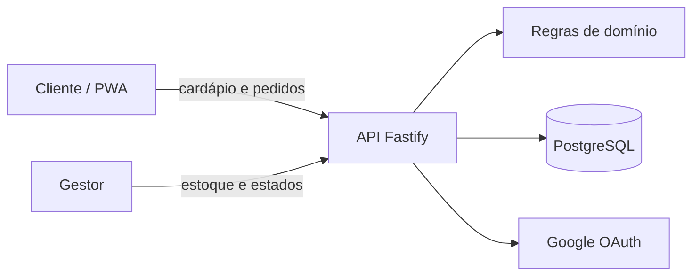

<h1 align="center">
  <br>
  
  <br>
  Tiulu Pastéis
  <br>
</h1>

<h4 align="center">Seu intervalo com pastel quentinho, pronto para retirar</h4>

Aplicação web responsiva com PWA para pedidos de retirada em uma pastelaria universitária.
React + TypeScript + Vite, API Fastify e PostgreSQL. Monólito modular para uma única loja.

Cardápio público, sacola e pedido antecipado para retirada, com login, localização no campus
IBILCE e acompanhamento. O estoque é reservado no envio e o preparo pode começar antes da
chegada; Pix e cartão são pagos no balcão. Tiulu nos fundos da ASTAIBILCE.
Salgados e mini pizzas a R$ 8; combos pastel + refri 200 ml a R$ 15 (grande) ou R$ 10 (pequeno).
Gestão em `/gestao`, sem link público. Novo catálogo exige informar estoque real no painel. Recursos
e limites: [conceitos fundamentais](docs/arquitetura/conceitos-fundamentais.md).

## Executar localmente

Requisitos: Node.js 22+, npm e PostgreSQL 17.

```bash
cp .env.example .env
npm ci
# Configure DATABASE_URL no arquivo local antes de aplicar a migração.
node --env-file=.env --import tsx src/server/migrate.ts
node --env-file=.env node_modules/concurrently/dist/bin/concurrently.js "tsx watch src/server/index.ts" "vite --host 0.0.0.0"
```

Abra `http://localhost:5173`. O Vite encaminha `/api` à porta 3000. Nunca versione `.env`.
[Configuração local e alternativa Docker](docs/operacao/configuracao-local.md).



## Capítulos

### Configuração e setup

- [Configuração local](docs/operacao/configuracao-local.md) — Node.js, Docker e ambiente.
- [Google OAuth](docs/integracoes/google-oauth.md) — login e configuração do provedor.

### Conceitos fundamentais

- [Conceitos fundamentais](docs/arquitetura/conceitos-fundamentais.md) — comportamento e limites.
- [Glossário](CONTEXT.md) — termos do domínio.
- [Fluxo de pedidos](docs/arquitetura/fluxo-de-pedidos.md) — criação, estados e retirada.

### Arquitetura

- [Camadas e conexões](docs/arquitetura/camadas-e-conexoes.md) — responsabilidades e dependências.
- [Dados e persistência](docs/arquitetura/dados-e-persistencia.md) — esquema e transações.
- [Autenticação do cliente](docs/arquitetura/autenticacao-do-cliente.md) — sessão e permissões.
- [Contratos de integração e API](docs/arquitetura/contratos-de-integracao.md) — rotas e limites.

### Operação

- [Implantação e recuperação](docs/operacao/implantacao.md) — HTTPS, backups e homologação.
- [Observabilidade](docs/operacao/observabilidade.md) — logs, health e diagnóstico.
- [Pagamentos](docs/integracoes/pagamentos.md) — pagamento presencial e integração futura.

### Qualidade e desenvolvimento

- [Visão geral das avaliações](docs/qualidade/visao-geral-de-avaliacoes.md) — verificações e lacunas.
- [Harness de desenvolvimento](docs/qualidade/harness.md) — regras, workflows, hooks e CI.
- [Desenvolvimento orientado a especificação](docs/processos/desenvolvimento-orientado-a-especificacao.md).
- [Decisões arquiteturais](docs/decisoes/README.md) — ADRs, status e paths regidos.
- [Índice completo](docs/README.md).

## Atalhos

```bash
npm run format:check
npm run lint
npm run typecheck
npm test
npm run build
docker compose -f compose.validation.yaml run --rm quality
docker compose -f compose.validation.yaml run --rm integration
docker compose -f compose.validation.yaml run --rm harness
```

Testes PostgreSQL modificam dados e exigem banco isolado. `AGENTS.md` é a fonte canônica de
instruções; revisão humana ou automatizada segue `REVIEW.md`. Nenhum deploy é automático.
