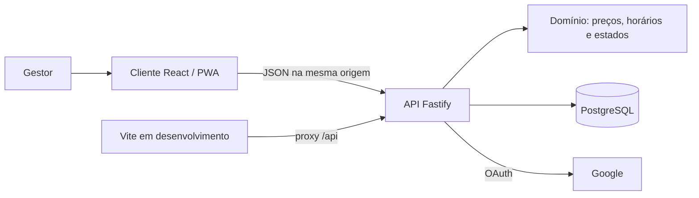

# Camadas e conexões

TypeScript nas duas camadas reduz o custo de manutenção. Fastify oferece HTTP, cookies e limites
de requisição; Zod valida entradas; `pg` mantém SQL e transações explícitos. React e Lucide
compõem a interface. PostgreSQL atende às relações e à atomicidade de pedidos, estoque e sessões.

| Camada              | Paths         | Contrato                                              |
| ------------------- | ------------- | ----------------------------------------------------- |
| Domínio             | `src/domain/` | regras puras sem imports de infraestrutura            |
| HTTP e persistência | `src/server/` | autenticação, autorização, SQL e transações           |
| Apresentação        | `src/client/` | sacola no aparelho e consultas; servidor decide fatos |
| Esquema             | `db/`         | migrações incrementais e catálogo da loja             |
| PWA                 | `public/`     | assets e fallback offline; API não é cacheada         |

Produção serve o bundle Vite pela API. Desenvolvimento usa proxy Vite para a porta 3000.
Não escalar horizontalmente sem rever rate limiting, atualmente local ao processo.

A georrestrição é regra pura de domínio, aplicada pela API na criação. O cliente solicita uma
posição recente e orienta falhas de permissão/precisão; não decide autorização ou reserva.
O contorno e limites estão no [fluxo de pedidos](fluxo-de-pedidos.md).
