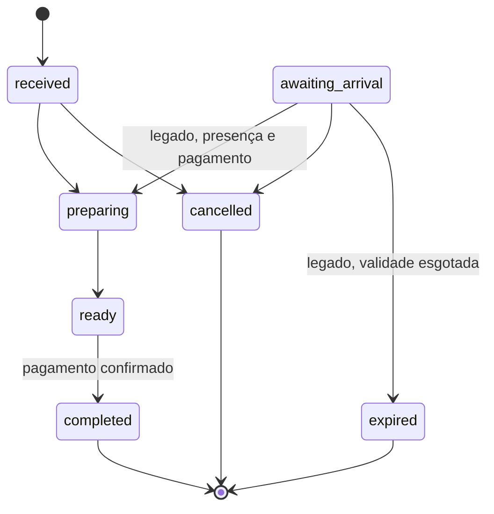

# Fluxo de pedidos

1. O cliente autenticado escolhe produtos, informa nome/observações e aceita a retirada pessoal.
2. Ao enviar, permite obter sua localização. A API valida origem, schema, expediente, conta,
   limite de três pedidos ativos e localização dentro do campus IBILCE de São José do Rio Preto.
3. A transação bloqueia os produtos em ordem de ID, valida estoque e calcula o total no servidor.
   Reserva, pedido, itens e evento são gravados atomicamente. O pedido nasce em `received`,
   com `stock_reserved=true`, `confirmed_at` na criação e `expires_at=null`.
4. O gestor inicia o preparo antes da chegada, sem exigir presença ou pagamento antecipado.
5. O cliente acompanha as etapas e vai buscar quando estiver pronto. Pix ou cartão são pagos
   presencialmente; a entrega exige pagamento confirmado pelo gestor.
6. O QR identifica o pedido na retirada, como opção de consulta; sua leitura não é requisito
   para preparar, não comprova pagamento e não autoriza acesso a detalhes.

O Tiulu fica nos fundos da ASTAIBILCE, conforme indicação do responsável. Não há marcador
geográfico exato do balcão. A retirada é pessoal, sem entrega ou motofrete.

## Localização no envio

`location` contém `latitude`, `longitude`, `accuracy` em metros e `timestamp` em milissegundos
Unix. A posição deve ter no máximo 120 segundos, tolerando até 10 segundos de relógio adiantado,
e precisão maior que zero e de até 100 metros. O círculo de precisão inteiro precisa caber no
polígono do campus; estar perto ou apenas ter o centro dentro não basta. Falha de permissão,
posição indisponível, imprecisa, antiga ou externa impede o novo pedido. A sacola é preservada.

A API decide a restrição; validação no cliente serve à orientação. A localização não é persistida
no banco, em armazenamento do navegador ou em logs. O navegador pode informar coordenadas
falsificadas: esta restrição não é prova de presença nem comprovação de vínculo institucional.
Não há rastreamento contínuo. Acompanhamento e retirada não exigem nova localização.

O contorno usa o [OpenStreetMap, way 228464680](https://www.openstreetmap.org/way/228464680),
[geometria primária](https://api.openstreetmap.org/api/0.6/way/228464680/full), versão 13,
consultada em 28/10/2026. Dados © colaboradores do OpenStreetMap, ODbL 1.0. É um mapa
colaborativo e precisa de homologação no campus, incluindo suas bordas e a ASTAIBILCE.
O [IBILCE](https://www.ibilce.unesp.br/) confirma o endereço Rua Cristóvão Colombo, 2265.
O [IBGE, estação SJRP](https://geoftp.ibge.gov.br/informacoes_sobre_posicionamento_geodesico/rbmc/relatorio/Descritivo_SJRP.pdf)
fornece um ponto geodésico no prédio da Diretoria, dentro do contorno; não define os limites do campus.

## Estados e compatibilidade

Cancelar um pedido recebido repõe o estoque reservado uma única vez, na mesma transação do
estado e evento. Preparo e pronto não têm cancelamento automático. Pedidos novos não expiram.
O limite de três ativos inclui `received`, `preparing`, `ready` e o legado `awaiting_arrival`.

Pré-pedidos antigos em `awaiting_arrival` conservam validade de duas horas, sem reserva inicial,
e confirmação presencial com pagamento e baixa atômica para iniciar preparo. A expiração é
materializada nas operações de pedidos. Não converter pedidos antigos silenciosamente.

Novos pedidos rejeitam agendamento. O expediente pode ser liberado explicitamente apenas em
desenvolvimento, conforme [configuração local](../operacao/configuracao-local.md).
O helper de agendamento permanece para compatibilidade com contratos legados.

Detalhes exigem titular ou gestor. O QR contém somente `tiulu:order:<uuid>`, sem dados pessoais
ou credenciais. Código secreto de acompanhamento continua compatível com pedidos anteriores.
O leitor exige HTTPS/localhost e permissão de câmera, com consulta manual alternativa.

Não existe chave de idempotência na criação. Se a conexão cair após o envio, conferir o histórico
antes de reenviar. Não enfileirar pedidos offline nem repetir a criação automaticamente.

Fontes de implementação: `src/domain/orders.ts`, `src/domain/campus.ts`, `src/server/app.ts`,
`src/client/OrderDetails.tsx` e `tests/integration.test.ts`.
