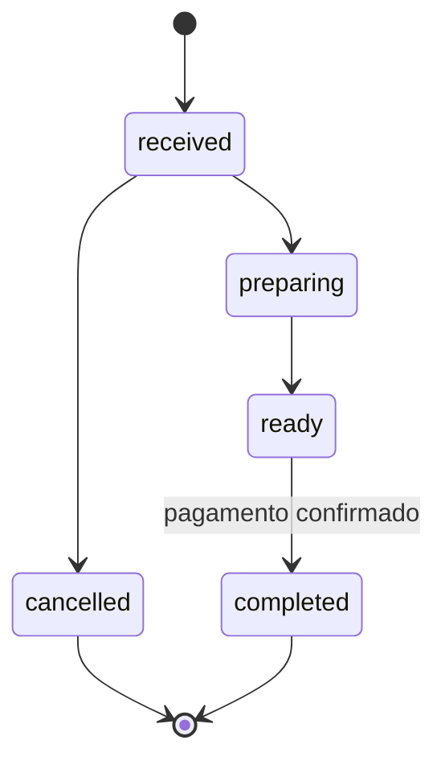

# Fluxo de pedidos

1. O cliente envia IDs, quantidades, nome, observações e opção de retirada/pagamento.
2. A API valida schema, origem, horário e forma de pagamento.
3. A transação bloqueia produtos em ordem de ID, verifica estoque e calcula o total pelo catálogo.
4. Pedido, itens, evento e baixa de estoque são gravados atomicamente.
5. A resposta contém ID, total e código secreto; somente o hash do código fica no banco.
6. O cliente acompanha por código ou pelo histórico da sessão autenticada.

Cancelamento só ocorre em `received` e repõe estoque na mesma transação. Pagamento tem estado
próprio (`pending` ou `paid`); chegar a `completed` exige `paid`. O histórico preserva nome e preço
dos itens na compra.

Não existe chave de idempotência na criação. Se a conexão cair após o envio, conferir histórico
ou balcão antes de reenviar. Não enfileirar pedidos offline nem implementar retry automático
de criação sem resolver duplicidade.

Fontes: `src/domain/orders.ts`, rotas de pedidos em `src/server/app.ts`, `tests/orders.test.ts`
e `tests/integration.test.ts`.
